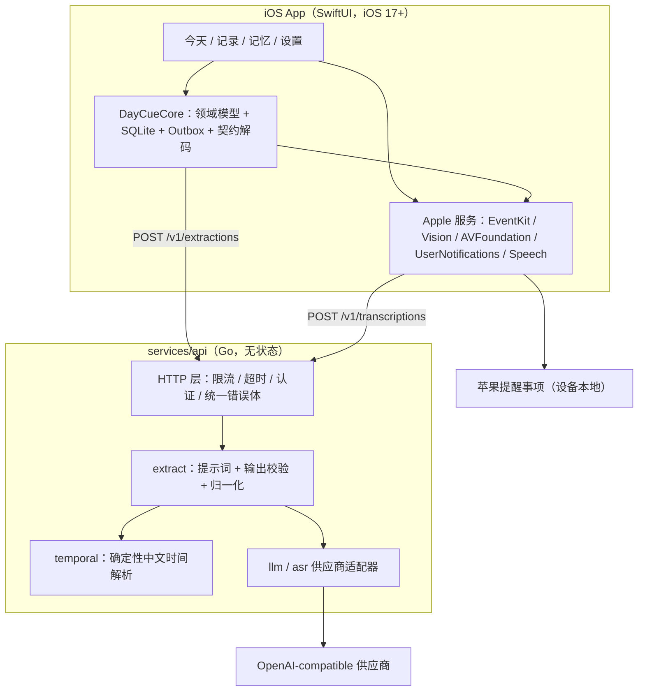

# DayCue 架构说明

本文只描述**已经实现**的结构，以及每个关键取舍的理由。设计与产品依据见 [product-scope.md](product-scope.md) 和根目录的 `proactive-assistant-design.md`。

## 1. 全景



**边界**：只有 iOS 端持有系统权限和 EventKit 写入能力。后端不接触用户的任务库、提醒事项和日历，也不落任何用户数据。

## 2. 六个关键决策

### 2.1 模型不许算日期

模型被要求只输出**原文里的时间说法**（`date_expression`，例如「明晚八点」「周五之前」），绝对时刻由 Go 端的 `internal/temporal` 用真实日历和 IANA 时区算出。

理由：日期换算是模型的稳定弱项，而错误的时间是这个产品最严重的失败——用户会因此错过作业。把算数从概率系统里拿出来，变成可单元测试的确定性代码，是这一层唯一正确的分工。

这条规则在代码里是强制的：`normalize.go` 里定义的结构体根本没有 `resolved_due` 字段，模型即使返回了也会被丢弃。

### 2.2 截止时间与提醒时间分离

`due`（截止）和 `remind`（提醒）是两个字段。只有出现明确时刻才生成 `remind`；「周五之前」这类表达只产生日期型 `due`，并附带 `deadline_only` 歧义标记。

理由：产品承诺「不擅自编造提醒时刻」。用户说「周五之前交」时，替他决定「周五早上 9 点提醒」是一种看似贴心、实则越权的行为。缺时间就如实显示「尚未设置提醒时间」。

### 2.3 契约优先

`contracts/` 是客户端与后端之间唯一的事实来源，并且被**测试强制执行**：`internal/extract/extract_test.go` 会读取 `contracts/fixtures/extract-os-pv.response.json` 做逐字段比对。改实现而忘了改契约（或反之）会让测试红。

请求体解析使用 `DisallowUnknownFields`：契约外的字段（比如伪造的 `user_id`）直接 400，而不是被静默接受。

### 2.4 本地优先 + 确定性幂等

所有捕获（文字/音频/图片）先写本地 SQLite，再谈网络。外部写入走 `outbox_operation` 表，幂等键是 `create_reminder:<taskId>:<listId>` 的 SHA-256 前缀——**确定性生成**，不是随机 UUID，并由唯一索引兜底。

理由：重复点按、网络重试、进程崩溃都不应该让用户在苹果提醒事项里看到两条一样的作业。随机键做不到这一点，确定性键可以。

### 2.5 写入状态必须四态可见

`not_requested / waiting_for_permission / pending / written / failed / unknown / needs_reconciliation`

界面上必须分别显示「已保存到 App」「等待写入苹果提醒事项」「已写入苹果提醒事项」「写入失败」。**没有系统成功回执就不许显示已写入**，`unknown` 必须走对账而不是重写。

理由：设计文档第 15 节要求「记录成功、AI 解析成功、系统写入成功、通知安排成功、用户互动」是五个独立阶段。把它们压成一个「成功」是对用户的欺骗。

### 2.6 零第三方依赖

iOS 端不用 GRDB / Alamofire，直接用系统 SQLite3；Go 端只用标准库。

理由：第一阶段的验证目标是「闭环是否成立」，不是「技术栈是否时髦」。少一层依赖，构建和排障的可控性就多一分；等真的需要时再引。

## 3. 目录

```
contracts/                    客户端与后端的接口事实来源（JSON Schema + fixture）
docs/                         范围、架构、验收
scripts/                      一键验收与本地启动脚本
services/api/                 Go 最小后端
  cmd/daycued/                入口
  internal/config/            配置 + 启动前安全校验
  internal/httpx/             错误体、中间件
  internal/temporal/          确定性中文时间解析
  internal/extract/           提示词、校验、归一化
  internal/llm/, internal/asr/供应商适配器
apps/ios/                     SwiftUI 应用
  Sources/DayCueCore/         跨平台纯逻辑（可在 macOS 上 swift test）
  Sources/DayCueApp/          SwiftUI 界面 + Apple 框架服务
  Tests/DayCueCoreTests/      单元测试
```

## 4. 一次「语音记录」的完整数据流

1. 用户按住录音 → `AVAudioRecorder` 写 `media/<captureId>.m4a`，**先落盘**。
2. `capture_item` 落库，状态 `local`；界面立刻显示「已保存到 App」。
3. 转写：优先系统 Speech 框架；不可用则 `POST /v1/transcriptions`；两者都失败就保留音频、标记失败，**绝不返回假文本**。
4. `POST /v1/extractions`（带 `recorded_at` 与 IANA 时区）。
5. 后端：提示词 → 模型 → 校验 → `temporal` 重算绝对时刻 → 契约响应。
6. 端侧进入预览页：每条候选显示 kind、标题、原文依据、时间表达、完整解析日期、歧义。
7. 用户确认 → 写 `task`（App 内）→ 若已授权且清单可写，再写 EventKit。
8. 写入结果回执落 `external_binding` 与 `action_receipt`；失败则状态为 `failed`，任务照常留在 App。

## 5. 失败路径（每一格都有对应实现）

| 情况 | 行为 |
|---|---|
| 无网络 | 捕获已落库；解析区显示失败与「稍后重试」；可手动建任务 |
| AI 超时 | 后端 504 `upstream_timeout`；记录保留；不触发任何系统写 |
| 模型返回非 JSON | 后端 502 `model_output_invalid`；响应里没有任何候选 |
| 模型编造原文依据 | 依据被清除并标记 `model_uncertain` |
| 拒绝提醒事项权限 | 任务仍在 App，状态「等待写入苹果提醒事项」，出现在今天页的同步异常区 |
| 写入时崩溃 | 重启后按稳定标识先查找再决定，不确定则标 `needs_reconciliation` |
| 用户改过识别文本 | `user_edited` 置位，晚到的解析结果不覆盖文本字段 |
| 外部项目已被用户改过 | 撤销时先比对 `lastModifiedDate`，不一致则只解绑不删除 |

## 6. 尚未实现（有意为之）

- 课表 / 课程实例 / 课后追问（第二阶段）
- 长期记忆的推断与检索（第三阶段）
- 位置围栏、双向同步、Android（第四阶段）
- 账号体系与云同步：第一阶段后端无状态，用户数据只在设备上

这些只保留契约与数据模型上的位置，不建空类、不放假接口。
