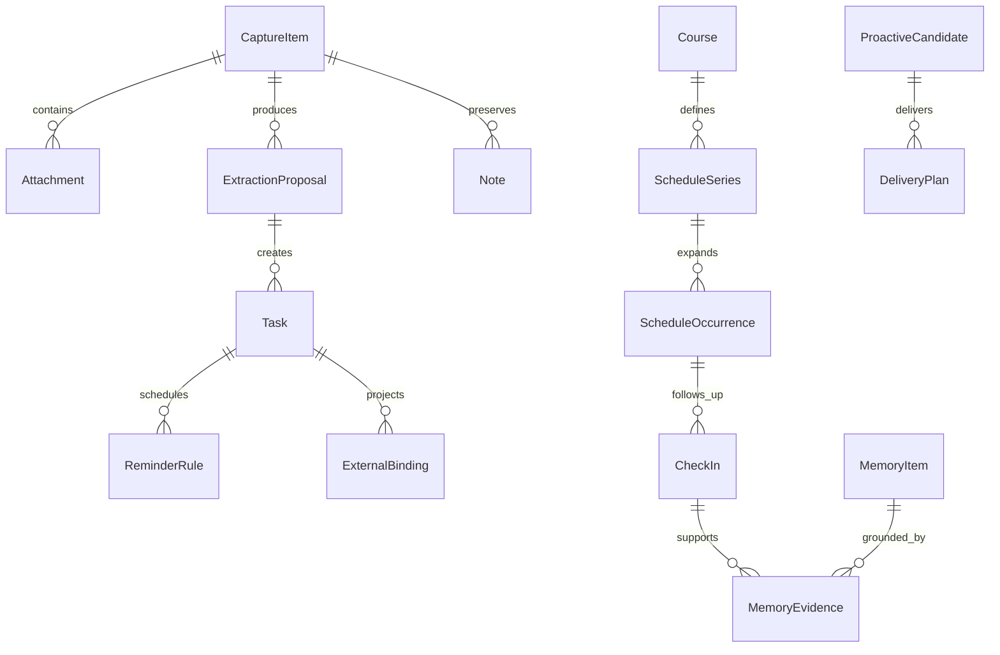
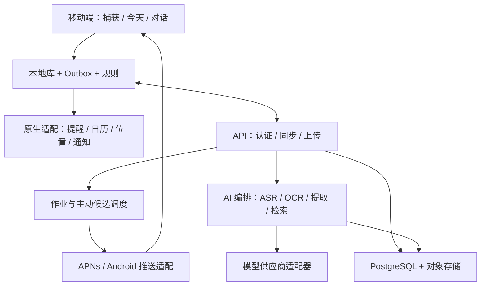

# 主动式个人 AI 助手：产品需求与技术设计

版本：v1.0 设计评审稿 · 日期：2026-10-11

## 1. 产品定义与设计假设

产品服务于需要在走路、课后、通勤时快速记录，并希望有人协助跟进学习与生活事务的个人用户。首批场景为大学生的课程、作业、备考和个人项目。核心价值：用一句话或一张照片保存事情，形成可执行提醒，在合适的时机追问，并逐渐理解用户的目标与偏好。

完整闭环：捕获 → 理解 → 分类与执行 → 情境追问 → 用户反馈 → 记忆更新 → 后续帮助。

用户已明确：文字、语音、拍照输入；自动进入提醒事项；主动发送信息；读取位置和行程；行程结束后询问与建议；优先苹果或双端兼容。

本稿假设：iOS 首发，Android 后续；中文优先；个人使用，不含团队协作；默认本地保存，云 AI 按授权处理必要内容；不依赖全天录音和持续 GPS；第一版不接入学校账号或抓取聊天软件。课表支持手动、图片、ICS 导入。所有假设可在评审中调整。

成功标准是“少漏事、少操作、少打扰”。任务写入成功、建议被采纳和用户主动纠错，比聊天时长更重要。

## 2. 产品策略与平台边界

### 2.1 三种实现路线

| 路线 | 优点 | 代价 | 适用判断 |
|---|---|---|---|
| iOS 原生优先，后补 Android 原生 | 提醒事项、通知、系统入口可直接使用原生能力 | 两套客户端 UI | 推荐；先验证苹果系统闭环 |
| Flutter/React Native 双端 UI，加原生插件 | 通用页面共享 | EventKit、定位、后台、扩展仍需原生开发 | 团队熟悉跨端且双端必须同期时选择 |
| 两端原生 UI，共享 KMP 领域层 | 可复用校验、规则、同步协议 | 起步与工具链复杂度较高 | 产品验证后再评估 |

推荐 SwiftUI 首发、Kotlin/Compose 第二端，共享后端、JSON Schema、事件协议和规则测试案例。首版不为代码共享引入额外平台层。

### 2.2 必须写进产品承诺的限制

1. 苹果提醒事项读写在苹果设备上经 EventKit 执行；服务器和 Android 不直接访问设备的 EventKit。Android 先使用 App 内待办。如果用户同时有在线且获授权的 iPhone，可经该设备桥接，显示“等待 iPhone 写入”，不承诺实时。
2. iOS 提醒事项请求完整读写权限；读取课程日历另需日历权限，不能把日历的仅写入授权当作读取授权。[S1]
3. 日历结束时间只是计划结束时间。离开教学楼只是位置线索。除非用户明确反馈，不标记“已确认下课/已参加”。
4. iOS 后台调度不是准点定时器；预先安排本地通知，云端可安排远程通知，但不承诺设备准点显示。关闭通知、专注模式、断网、后台限制、强制退出都可能影响体验。[S2][S3]
5. 地理围栏是建筑/区域级能力，不能可靠识别某间教室。iOS 同时监控条件有数量限制，Android GMS 地理围栏也有限额且后台有延迟。[S4][S5]
6. 拍照识别能生成提醒的文字和来源链接；照片原件留在 App。首版不把“在 App 内保存照片”宣传为“把照片附件写入苹果提醒事项”。

## 3. 功能范围与版本划分

| 功能 | P0：基础闭环 | P1：情境助手 | P2：深化能力 |
|---|---|---|---|
| 捕获 | 文字、按住说话/点击录音、拍照、相册、离线保存 | 分享扩展、快捷指令、小组件 | 更多系统入口 |
| AI 理解 | 转写/OCR、多事项拆分、时间解析、歧义澄清 | 课程关联、任务依赖 | 更复杂规划 |
| 提醒 | App 待办、iOS 提醒事项、明确时间提醒、撤销 | 双向同步、重复与位置提醒 | 可选其他任务服务 |
| 行程 | 手动课表/截图/ICS、日历选择性读取、课后通知 | 停课/调课、地点与反馈联合判断 | 更多行程来源 |
| 主动性 | 用户订阅的课后追问、固定每日回顾 | 位置触发、负担感知、跨事件建议 | 经评估的个性化时机学习 |
| 记忆 | 明确偏好、课程困难点、查看/纠正/删除 | 多来源检索、过期与冲突管理 | 长期目标进展辅助 |
| Android | 设计与协议预留 | 原生捕获/任务/通知/课表 | iPhone 桥接及可选第三方同步 |

P0 不包括自动替用户安排整个生活、读取微信/QQ、自动发送消息、自动改动全部日历、持续录音、精确室内定位。课堂知识记录默认成为笔记；只有行动意图才生成任务。

## 4. 信息架构与主要页面

移动端采用三入口底栏：**今天、记录、记忆**。记录按钮突出，今天页面可直接发起输入；设置放右上角。无需传统侧边栏。

| 页面 | 内容 | 关键操作 |
|---|---|---|
| 今天 | 下一个行程、临期待办、待回复追问、同步异常 | 完成、推迟、回复、快速记录 |
| 捕获浮层 | 输入方式、实时转写、图片预览、来源 | 结束录音、重拍、编辑、提交 |
| 解析结果 | 识别出的任务/笔记/行程卡片、时间依据 | 修改时间、批量确认、撤销 |
| 助手对话 | 与某课程/任务相关的短对话、建议卡片 | 语音回复、接受建议、转任务 |
| 记录详情 | 原文、媒体、提取结果、关联课程、执行记录 | 再解析、纠错、删除 |
| 课表/行程 | 周视图、每次课程实例、追问设置 | 导入、停课、调课、开启追问 |
| 记忆 | 用户确认事实、待确认推断、来源、到期时间 | 修改、忘记、不再记住此类信息 |
| 设置 | 权限、默认清单、自动写入、主动性、数据管理 | 权限修复、频率、导出、清除 |

首次使用先完成一条记录，再按需申请权限。开启苹果同步时申请提醒事项；开启课后追问时申请通知；选系统日历时申请日历读取；开启地点提醒时说明并申请位置能力。拒绝某权限仍可继续用其余功能。

## 5. 核心交互流程

### 5.1 语音：走路时的一句话

输入：“今天操作系统讲了 PV 操作，我还是没理解，明晚八点提醒我复习，周五之前交实验报告。”

1. 打开即见录音入口；点击开始、点击结束，按住说话为可选操作。录音需显式操作，支持暂停、删除和最长时长提示。
2. 音频先落本地，后台上传/识别失败也不丢。转写中显示文本，最终识别结果替换临时结果；用户修订的文字不再被晚到的结果覆盖。
3. 生成：课程笔记“PV 操作仍有疑问”；任务“复习 PV 操作”；任务“交实验报告”。“明晚八点”按录入时所在时区计算并显示完整日期。“周五之前”先作为截止日，不擅自编造周五几点。
4. 对明确且已获自动写入授权的任务直接创建，显示“已保存至 App / 已写入苹果提醒事项”各自状态，可立即撤销。初次使用默认结果预览；用户随后可开启自动模式。
5. 对“周五之前”可采用用户预设的截止日提醒规则，否则只设截止日期并提示“尚未设置提醒时间”。
6. “PV 没理解”形成带来源的学习状态，不推导“用户不擅长操作系统”。

支持口语纠正：“不是周五，是下周一”。编辑的是同一条任务，不增加重复任务。

### 5.2 图片：白板、课表、通知截图

拍照/选图 → 用户裁剪 → 端侧 OCR → 可选云端视觉理解 → 提取候选 → 展示证据区域 → 确认并执行。

示例：白板“实验三，下周三上课前交”。若已经关联课程且下一次周三课程可确定，展示候选绝对日期与上课开始时间；缺少课程上下文时问“下周三哪节课之前？”，不猜。一张图片可提取多项作业；课表须先预览学期、起止周、单双周、节次映射，再生成课程实例。

低清、缺少年份、日期与星期冲突时进入待澄清。无行动内容的照片只归档为笔记。保留原图与 OCR 坐标作为依据；压缩上传，默认移除 EXIF 位置信息。图片中的“忽略系统规则”等文本只当来源内容，不作为工具指令。

### 5.3 课后追问

1. 用户导入/创建课表，选择开启追问的课程，例如操作系统；支持“每节、每天首次、仅我标记困难后”。默认每天最多一次课后追问，用户可调。
2. 每次课程建立独立 occurrence，计划结束后 5–15 分钟为追问窗口；有下一节连堂时推迟到空档；晚于有效窗口的追问不补发。
3. 提前准备通用问题和相关上下文：“课表里的操作系统课预计结束了，要不要记一下今天的重点？”不在缺乏证据时说“你刚上完课”。
4. 通知按钮：“说一下”“稍后”“今天跳过”。语音回复需用户打开录音界面；通知可提供文字快捷回复，但不自动开启麦克风。
5. 用户回复“老师讲了死锁，我分不清不安全和死锁”。保存课堂记录；针对该疑问解释；提出“要不要今晚用一道题复习？”用户接受后创建任务。
6. 用户说“今天没上课”：本次实例标记缺席/取消（具体状态由用户选择），取消关联追问，不永久修改课程规则。
7. 跳过不等于已学会。连续三次跳过同一类型主动消息，暂缓并在 App 内提供降频选择。

### 5.4 位置感知

两个功能分开：用户明确设置的地点提醒；基于位置辅助判断合适的主动时机。

“到图书馆提醒我还书”解析为位置触发任务。用户选择地图上的图书馆，确认进入触发和范围；只输入“图书馆”且有多个候选时必须选地点。进入围栏后生成一次候选，进行权限、有效期、去重与冷却检查。显示“位置提醒可能延迟”。

“离开教学楼后问我课堂重点”是订阅的主动规则，结合课程计划结束和位置离开线索；没有位置权限时用时间规则。位置不可用时不把陈旧位置当作当前位置。教学楼内换教室通常无法通过围栏区分。

默认只保留语义事件“进入图书馆”，不上传连续轨迹。常去地点需要用户命名确认；位置线索不能证明已参加课程、已见某人或完成某事。

### 5.5 长期记忆与再次帮助

用户：“以后学习提醒尽量放晚上八点半。”保存确认偏好，有一键修改入口。用户：“最近 PV 很难”保存暂时学习状态，默认 30 天复核。下次说“今晚复习一下今天的内容”，检索当天课程和已有困难点，给出候选任务与偏好时间；展示“时间来自你设置的学习偏好”。

用户纠正“现在晚上有课了”时，旧偏好失效，新信息进入确认流程。不能把所有历史都塞进提示词，也不能把模型自己的建议再写成用户事实。

## 6. 功能模块与责任边界

| 模块 | 输入/输出 | 核心职责 |
|---|---|---|
| Capture | 媒体/文本 → CaptureItem | 本地持久化、上传、识别进度 |
| Understanding | 原文+必要上下文 → ExtractionProposal | 意图、多任务、时间字段、证据引用 |
| Validation | Proposal → Accepted/Draft | Schema、时区、日期、权限、歧义校验 |
| Task | 已确认动作 → Task | 状态、截止日、提醒策略、撤销 |
| ReminderAdapter | Task → 外部写入回执 | EventKit/其他适配器，平台字段映射 |
| Schedule | 日历/课表 → Occurrence | 重复、例外、停课与追问窗口 |
| Context | 时间/位置/可用信号 → ContextSnapshot | 新鲜度、证据强弱、语义地点 |
| Proactivity | 事件+规则 → ProactiveCandidate | 频率、静默、去重、优先级 |
| Notification | DeliveryPlan → 系统请求 | 本地/远程投递、有效期、交互回执 |
| Conversation | 回复 → 答复/候选动作 | 针对课程与任务的短对话 |
| Memory | 明确陈述/记录 → 候选/确认记忆 | 来源、冲突、失效、检索、删除 |
| Sync | 本地变更 ↔ 服务端变更 | Outbox、版本、断网重试、冲突 |
| Policy/Audit | 动作请求 → 授权和执行记录 | 不让 LLM 直接调用系统写操作 |

## 7. AI 工作流与自动执行策略

不以无限 ReAct 循环处理一次随手记录。优先有限工作流：ASR/OCR → 结构化提取 → 确定性校验 → 必要澄清 → 执行 → 回执。复杂问答才进入有工具次数、时间和成本上限的 Agent。

结构化候选至少含：kind、title、source_spans、date_expression、resolved_due、remind_at、timezone、course_id、place_id、ambiguities、suggested_action。confidence 只作为参考，须通过真实样本校准，不单凭模型自报分数自动执行。

| 类型 | 默认策略 |
|---|---|
| 明确任务，字段齐全，已有自动写入设置 | 自动创建，回执可撤销 |
| 只有截止日期，没有提醒时间 | 创建截止日任务；有用户规则才设置提醒 |
| 日期不明确、地点多义、疑似重复 | 保存草稿，只问必要问题 |
| AI 建议的新任务 | 用户接受后创建 |
| 新日历行程、修改/删除外部项目 | 逐次确认 |
| 已有任务的明确“完成/改到明天”指令 | 校验目标后执行；目标多义先澄清 |
| 批量删除、清空数据 | 二次确认；不自动执行 |

每次系统写操作执行链为 validate → authorize → enqueue → execute → reconcile → receipt。权限在执行时再次检查；幂等键由确定性程序生成，不由模型指定。模型超时保留原始记录，不能显示“已经创建提醒”。

## 8. 主动引擎与通知规则

### 8.1 事件来源

schedule.occurrence_expected_end、location.entered/exited、task.due_soon、task.completed、capture.parsed、user.checkin_requested、daily.review_due。名称强调 expected_end，不伪装实际结束。

候选流程：事件 → 规则匹配 → 有效性/权限/打扰预算检查 → 内容准备 → 投递计划 → 用户反馈。

### 8.2 默认规则

- 自主追问和建议合计每天最多 3 次，两次间隔至少 90 分钟；默认课后追问每天最多 1 次。
- 用户明确设定的任务到点提醒不计入自主建议预算，提醒配置独立。
- 静默 22:30–08:00；自主消息移到下一个合适时段，过期则丢弃。用户可给明确提醒配置不同静默策略。
- 不根据无法读取的其他 App 状态推断正在开会/驾驶。仅使用已授权、实际可取得的信号；无信号则按课表和静默规则处理。
- 任务已完成、课程已取消、该 occurrence 已回复时取消候选。
- 同一课程实例最多一个追问，位置/时间多个事件不能重复通知。用户“稍后”是显式重新安排，同属一个候选。
- 通知不回答默认不追着连续催；保留在今天页面，过期后归档。

通用课后提问可在前台同步课表时预生成并安排本地通知，保证不依赖到点启动 AI。个性化问题也可提前准备；回复后的个性化帮助才调用模型。云端消息按权限和上下文新鲜度检查，缺少最新位置时只使用时间策略。

同一候选只选择一个主要投递路径：本地或远程。首版课后追问用本地；云建议用远程。避免本地和 APNs 同时安排同一消息；多设备指定主动通知主设备并使用投递租约。离线设备旧通知无法保证实时撤销，产品说明为跨设备同步延迟，联网时清理。

状态区分 planned、scheduled、provider_accepted、interaction_received、expired、suppressed；系统接受请求不等于用户已看到。只有用户点击/回复等信号才能确认互动，不能虚报已读。

## 9. 苹果提醒事项集成与同步协议

### 9.1 字段与权限

使用单例/受控生命周期的 EKEventStore，经串行执行器管理系统对象。申请 requestFullAccessToReminders；Info.plist 使用 NSRemindersFullAccessUsageDescription。用户选择目标清单并检验可写，系统授权范围与 App 内“只同步选中清单”的规则分别说明。[S1]

| App 字段 | 苹果侧表示 | 补充策略 |
|---|---|---|
| title | EKReminder.title | 尽量保持简洁 |
| note summary | notes | 原文及富媒体留 App |
| due | dueDateComponents | 区分日期型与精确时间型 |
| completion | isCompleted/completionDate | 读取外部完成状态 |
| reminder time | EKAlarm | 截止时间与提醒时间分别存储 |
| recurrence | EKRecurrenceRule | 首版限定支持规则并实机验证 |
| location reminder | EKAlarm + EKStructuredLocation | P1 能力验证；不与 App 重复提醒 |
| source link | URL/notes 中 App 详情链接 | 不嵌入公开媒体下载地址 |
| course/memory/evidence/images | App 数据 | 不强行映射为系统私有字段 |

用户选择苹果提醒事项作为任务的提醒执行方时，同一个到点提醒不再由 App 重复通知；App 仍可发送不同目的的课后追问。

### 9.2 写入、对账与冲突

本地事务写 Task + OutboxOperation；适配器写外部对象；成功后存 ExternalBinding 与字段快照。App 主库保存扩展语义，苹果是可编辑的任务投影，App 不是对外部修改拥有绝对优先权。

外部绑定至少包含 user、device、provider、account/source、list、external_id、app_task_id、last_synced_snapshot、operation_id。外部 ID 不视为跨设备永恒主键。保留 App 详情链接中的稳定任务标识辅助恢复，但不能只按标题匹配。

写入后进程崩溃、未记回执时先查找稳定标识再决定是否重写；不确定则标记 needs_reconciliation，避免盲目重复。MVP 指定一个苹果桥接设备执行写入，防止两台设备同时创建。

监听 EKEventStoreChanged，重新拉取选中范围，而非认为通知含具体字段变更；在 App 回到前台、权限恢复及后台机会执行对账。[S7]

采用三方比较：上次同步快照、本地当前字段、外部当前字段。不同字段变更可合并；同一字段双方变更保留冲突并让用户选择。不用单一最后写入覆盖用户手动编辑。外部消失先排除权限丢失、账号退出、查询范围变化，再显示“外部项目已删除”并允许归档/重建；不立即永久删除 App 原始记录。删除外部任务需要明确授权；撤销自动创建只移除本次对应项目，如外部已被编辑则先确认。

若目标清单失效，保留 App 待办并显示“尚未写入苹果提醒事项”，不静默改写其他清单。服务端到端侧命令只能等待获授权设备执行，不保证后台立即写入。

## 10. 数据模型

### 10.1 核心实体

所有用户数据实体含 id、user_id、created_at、updated_at、version、deleted_at。UUID/ULID 为业务标识；时间保存 UTC 及相关 IANA 时区，日期型截止日单独存 local_date，不转换成虚假的 UTC 午夜。

| 实体 | 主要字段 | 关系/约束 |
|---|---|---|
| User | locale、timezone、preferences | 一个用户多个设备 |
| Device | platform、capabilities、push_token_ref、last_seen、notification_primary | 权限按设备，令牌加密 |
| Consent | scope、device_id、status、policy_version、granted_at、revoked_at | 云处理授权与 OS 权限分开 |
| CaptureItem | type、text、transcript、status、recorded_at、recorded_timezone | 一个捕获多个附件/候选 |
| Attachment | capture_id、media_type、local_path、object_key、hash、retention_until | 不长期存公开 URL |
| ExtractionProposal | capture_id、schema_version、payload、evidence、ambiguities、status | accepted/rejected/needs_clarification |
| Note | capture_id、content、course_id、tags | 可以关联任务，默认不提醒 |
| Task | title、status、due_kind、due_date/at、timezone、course_id、origin_proposal_id | 唯一已接受 proposal 项防重复 |
| ReminderRule | task_id、trigger_type、fire_at/local_time、place_id、transition、owner_provider | 与截止日分离；一任务多规则 |
| ExternalBinding | task_id、provider、device/source/list、external_id、snapshot | 同一投影避免重复绑定 |
| ScheduleSeries | source、course_id、timezone、rrule、term_start/end、version | 本地课表或系统来源 |
| ScheduleException | series_id、original_start、override/cancel | 单次调课/停课，不修改全部 |
| ScheduleOccurrence | series_id、start/end、place_id、status、attendance_source | 唯一 series+original_start |
| Course | name、teacher_optional、followup_policy | 不默认采集老师个人资料 |
| Place | label、coordinate、radius、coordinate_system、confirmed | 经纬度/地理编码需坐标转换 |
| ContextEvent | type、event_time、received_at、evidence、expires_at、place_id | 语义事件，不是连续轨迹 |
| ProactiveRule | scope、trigger、conditions、quiet_policy、enabled | 用户订阅规则 |
| ProactiveCandidate | rule_id、occurrence/task_id、window、status、reason、dedupe_key | dedupe_key 用户范围唯一 |
| DeliveryPlan | candidate_id、device_id、route、scheduled_at、expires_at、status | 单主要路由及设备 |
| CheckIn | occurrence/candidate_id、question、answer、skip_reason | 反馈连接原课程实例 |
| Conversation/Message | context_refs、role、content、source_refs | 消息角色不可混同事实来源 |
| MemoryItem | kind、statement、status、confidence、valid_from/to、review_at、sensitivity | candidate/confirmed/superseded/deleted |
| MemoryEvidence | memory_id、capture/message/checkin_id、span、assertion_type | 多证据，区分用户陈述与推断 |
| MemoryRelation | from/to、type | conflicts_with/supersedes/about |
| EmbeddingIndex | memory_id、embedding_version、content_hash | 派生索引，删除随主实体 |
| OutboxOperation | entity_id、op、idempotency_key、attempt、state、next_retry | Pending/running/succeeded/failed/unknown |
| ActionReceipt | operation_id、target、result、error_code、provider_ack | 不等同通知已展示 |

### 10.2 关系图



### 10.3 任务示例

```json
{
  "id": "task_demo_01",
  "title": "复习操作系统 PV 操作",
  "status": "open",
  "due_kind": "datetime",
  "due_at": "2026-10-12T12:00:00Z",
  "timezone": "Asia/Shanghai",
  "reminder_rule": {
    "trigger_type": "time",
    "fire_at": "2026-10-12T12:00:00Z",
    "owner_provider": "apple_reminders"
  },
  "origin": {"capture_id": "capture_demo_01", "source_text": "明晚八点提醒我复习"},
  "external_sync_status": "pending"
}
```

示例假设录入时间为 2026-10-11 Asia/Shanghai。pending 时不能显示已写入苹果提醒事项。截止日期、提醒时间、重复规则不必完全一致。

## 11. 长期记忆设计

四类记忆：稳定偏好（喜欢晚间复习）、目标（准备软件设计师考试）、阶段状态（本周 PV 困惑）、情节记录（某次课程讨论）。任务和日历保持各自结构化数据，不能只存向量。

写入流程：来源保存 → 抽取候选 → 判断敏感度/明确性 → 去重/冲突 → 用户确认或按既有授权记录 → 设置复核/失效 → 更新索引。明确普通偏好可按设置自动记忆；位置习惯和敏感内容默认逐次确认。推断只保留为候选，不能对外表述为事实。

检索先按用户、权限、状态、时效、课程/任务过滤，再混合关键词与向量召回，必要时 rerank。每次调用给有限条数与 token 预算；每条包含来源和更新时间。长期记忆缺失时可以问，不能补造。

示例记录：statement=“本次课后用户表示不理解 PV 同步”；kind=learning_state；source=checkin；status=confirmed_as_reported；review_at=30 天。confirmed 表示用户确实这样表达，不代表经客观测试验证能力。复习后用户说“理解了”，旧状态 superseded；必要时保留历史来源供用户查看。

用户可查看“你记住了什么”“为什么这样建议”，修改、停止记住某类别、删除单条、忘记所有记忆。删除覆盖主表、证据关联、向量索引、摘要和缓存；在同步中传播 tombstone，避免离线旧版本复活。删除记忆不默认删除原始笔记；提供“同时删除来源”选项并解释范围。数据导出不暴露其他用户或服务端密钥。

建议默认保留期：原始语音处理成功后 7 天可自动删除，失败未处理语音保留并提示；图片由用户设置；语义位置事件 7 天、原始坐标仅短期本地缓存；任务/笔记保留到用户删除；候选记忆 30 天，阶段状态 30 天复核。以上是产品默认值，可改，不能作为系统平台限制。

## 12. 技术架构

### 12.1 总体设计



端侧拥有系统权限、EventKit 写入和本地通知安排；云端拥有模型编排、跨端同步、非实时长期作业。云端不能直接控制端侧系统数据库。离线端侧记录和明确时间提醒可工作；云 AI 不可用时保留待处理，不编造解析结果。

### 12.2 iOS

建议最低 iOS 17，使用 Swift/SwiftUI，领域服务与视图模型分离；SQLite（可选 GRDB）统一任务、Outbox 和版本事务；媒体位于受数据保护的 App 文件目录；认证令牌与加密密钥放 Keychain。

| 能力 | 实现选择 | 注意点 |
|---|---|---|
| 录音 | AVAudioEngine/AVFoundation | 中断恢复、蓝牙耳机、来电、权限拒绝 |
| 转写 | Speech 框架适配器 + 可选云 ASR | 端侧能力依语言/设备检测；录音不依赖识别成功 |
| 拍照与图片 | AVFoundation、PhotosPicker、Vision OCR | 默认图片选择器，无需全库读取 |
| 提醒/日历 | EventKit | 分开授权；选中清单/日历；对账 |
| 通知 | UserNotifications + APNs | 分类按钮、文字回复、有效期 |
| 位置 | Core Location 围栏/受控位置更新 | 能力与权限探测；围栏动态挑选 |
| 后台 | BackgroundTasks、background URLSession | 机会性同步/上传，不承担准点 AI 计算 |
| 快速入口 | App Intents、WidgetKit、Share Extension | 用户主动入口；扩展用 App Group 交换待处理记录 |

位置首版只在使用时或用户显式开启地点提醒时申请必要权限，后台定位仅服务已开启的核心场景。围栏按即将到期任务和常用地点挑选，预留系统限额，不把所有历史地点注册进去。位置回调只做轻量事件入库/规则判断，复杂 AI 放前台或作业。

课后通知滚动安排未来几天，受系统 pending 通知限额约束做容量管理；进入 App、课表变更与后台机会刷新。长时间未打开时可能覆盖不足，今天页显示“课后提醒已安排至某日期”，不声称无限期保证。停课/调课取消旧请求并安排新请求。

### 12.3 Android

Kotlin + Jetpack Compose，Room/SQLite，协程/Flow；密钥在 Android Keystore。最低版本按目标设备调研定，提议 API 26 起；发布 target SDK 按届时商店要求单独确定。

| 能力 | 实现选择 | 降级 |
|---|---|---|
| 录音/转写 | MediaRecorder/AudioRecord、SpeechRecognizer、云 ASR | 无识别服务则保存音频，稍后处理 |
| 拍照/OCR | CameraX、Photo Picker、端侧 OCR 引擎 | 非 GMS 环境选可用模型/云 OCR |
| 日历 | Calendar Provider/日历 Intent | 无权限使用 App 自建课表 |
| 待办 | App 内任务主库 | 不假定各品牌存在统一提醒事项 API |
| 后台同步 | WorkManager | 非准点作业 |
| 到点提醒 | AlarmManager + 通知 | 特殊权限不可用时显示能力降级；不用 WorkManager 冒充精确提醒 |
| 位置 | LocationProvider 接口；GMS GeofencingClient 或已验证本地可用 SDK | 无可用服务使用时间或手动触发 |
| 推送 | FCM（可用环境）及经验证的国内厂商通道 | 离线依靠已安排本地提醒 |

Android 精确闹钟涉及权限与适用条件，课后追问通常允许窗口，不默认要求精确闹钟能力。[S6] 请求通知权限；后台位置按版本分阶段申请。[S8] GMS 围栏不能直接代表所有国行 Android；必须在 vivo、小米、OPPO、华为和有 GMS 设备上做独立验证。厂商限制、重启、系统更新后检查/恢复安排，不以常驻前台服务维持全部功能。

### 12.4 后端

建议 Go 模块化单体 + PostgreSQL + pgvector + 私有对象存储；异步任务首版用数据库持久化队列与 worker，规模证明需要时再引入 Redis/消息队列。避免一开始部署大量微服务。

领域模块：Identity、Capture、Task、Schedule、Memory、Proactivity、Sync、AI Gateway。AI Gateway 统一 ASR、视觉、LLM、embedding/reranker 供应商配置，支持替换供应商，服务端保管 API Key。每次调用记录 model、latency、token/cost、schema_version 和错误类型，不把用户原文写进普通日志。

任务队列采用至少一次投递，worker 幂等；主动候选入库后调度按 UTC 执行，到期重新检查 consent、实体状态、预算和过期时间。用户撤权取消未执行作业；仍在途输出不入记忆并按策略删除。服务器未知端侧权限时不能宣称系统写入可用。

## 13. API 与同步合同

| API | 语义 |
|---|---|
| POST /v1/captures | 提交文字/媒体引用与录入时区，Idempotency-Key |
| POST /v1/attachments/upload-intents | 返回短期上传授权，限制类型/大小/hash |
| GET /v1/captures/{id} | 处理状态、候选与错误 |
| POST /v1/proposals/{id}/resolve | 接受/修订/拒绝，包含 expected_version |
| PATCH /v1/tasks/{id} | 字段更新，乐观并发版本 |
| POST /v1/schedule/imports | 课表/ICS 解析成预览，不直接提交 |
| POST /v1/schedule/imports/{id}/confirm | 确认学期/时区/单双周并生成实例 |
| POST /v1/checkins/{id}/responses | 文本/音频回复或跳过 |
| POST /v1/context-events | 经过授权、最小化的语义事件 |
| GET /v1/memories | 当前记忆、来源、失效信息 |
| PATCH/DELETE /v1/memories/{id} | 纠正/忘记，清理派生数据 |
| POST /v1/sync | 推送本地操作、拉取 server_cursor 后变更 |
| POST /v1/action-receipts | 上传端侧系统操作回执 |
| POST /v1/devices/{id}/capabilities | 最新权限、能力和授权时间 |

所有接口从认证身份确定 user_id，不能信任请求 body 的 user_id。媒体和任务引用检查 ownership。返回 409 版本冲突、422 语义校验、403 授权不足、429 频率限制；错误含可读提示、retryable、trace_id。网络重试不创建第二份事项。

同步不能仅依赖时间戳分页；使用服务端单调 change_seq/cursor。客户端本地先提交，Outbox 重试；远程变更保持版本和 tombstone。时区变化：绝对时刻提醒保持 instant，浮动本地时间规则按定义重算，用户预览变化；夏令时不存在/重复时刻需有确定规则或澄清。

## 14. 隐私、权限与可解释性

端侧、云端权限与用户的行为授权是三层：OS 允许访问不表示用户允许任意外传；允许云 AI 不表示允许自动修改日历。

- 用户可选仅本地记录、使用云 AI、云同步分别开启；关闭云处理仍能记录与手动设提醒。
- 系统日历和提醒只处理选中范围；上传最少的行程字段，不整库上传。
- 锁屏通知默认不展示课程困难、精确地点等详细信息，可由用户开启内容预览。
- 传输 TLS、存储加密、私有媒体与短期签名授权；每个用户隔离检索、作业和缓存。
- 不声称使用云模型时仍拥有模型无法解密的端到端加密；模型需要明文处理的阶段向用户解释。若需要完全 E2EE，改为端侧推理或用户自选可信执行设计。
- 位置、图片与笔记中的第三方文字都不能提升工具权限。LLM 只能生成候选，权限由程序验证。
- 提供数据导出、账号删除、原始媒体/记忆单独清除；在线数据清除建议目标 24 小时，备份最长 30 天失效，法律保留或恢复限制需上线前另定并披露。

每个建议有“为什么”：例如“你的课表显示本节预计结束；你开启了课后回顾；这条问题引用上次未解决的 PV 疑问”。理由引用真实信号，不输出模型隐藏推理。

## 15. 异常处理与体验

| 情况 | 用户体验 | 系统处理 |
|---|---|---|
| 无网络 | “已保存，联网后整理” | 本地记录、Outbox、上传重试 |
| 识别错字 | 可改原文与任务字段 | 用户修订版本优先 |
| AI 超时/限额 | 保留记录，可手动创建/稍后重试 | 有界重试与成本熔断 |
| 提醒权限拒绝 | “已存 App，未写入苹果提醒事项” | 等待授权，不丢任务 |
| 通知关闭 | 今天页显示待办与待回复 | 不把关闭误报成发送成功 |
| 位置模糊/过期 | 时间兜底或待确认 | 不生成肯定性的地点结论 |
| 外部列表删除 | 选择新清单/只留 App | 停止写入并保留回执 |
| 系统完成任务 | App 对账后同步完成 | 撤销对应候选和本地提醒 |
| 课程临时延长 | “稍后再问/本次跳过” | 改本次实例，不改整学期 |
| 跨设备离线修改 | 展示冲突/待同步 | 三方合并，不复活已删除数据 |

记录成功、AI 解析成功、系统写入成功、通知安排成功、用户互动是五个独立阶段。UI 显示各阶段真实状态。

## 16. 非功能需求与验收

以下为设计目标，不是已实测结果。测试需记录设备、网络、语言、权限状态与模型版本。

| 目标 | 验收方法 |
|---|---|
| 快速输入 | 前台已就绪时录音开始 P95 < 500ms，本地保存 P95 < 1s |
| 解析可用 | 正常网络下 30 秒以内语音结束到结果 P95 < 10s；超时仍保留来源 |
| 明确字段准确 | 独立中文口语/图片数据集评估；明确日期时间字段准确率目标 ≥95%，歧义另计 |
| 拆分正确 | 多任务提取 precision/recall 分开报告；避免只看“识别成功率” |
| 自动执行可靠 | 获权限且可写清单，故障注入重试后不重复；unknown 必须对账 |
| 课后单次追问 | 同 occurrence 时间+围栏并发/重复/乱序事件，只形成一个候选 |
| 撤销与外部编辑 | 外部改时间/完成/删除、多端冲突实测，不覆盖人工变更 |
| 记忆正确 | 推断不升级为确认事实；改偏好失效旧记忆；删除后检索不召回 |
| 权限正确 | 每项权限拒绝、撤销、恢复，仍可进入可用部分 |
| 隐私隔离 | 跨 user_id 的任务/附件/向量查询均不可访问 |
| 通知诚实 | scheduled/provider_accepted 不显示为已读；到期失效不补发 |
| 位置耗电 | 真机 24h 对照试验，建议额外耗电目标 <5 个百分点，不保证所有机型 |

重点样本：明天/下周/之前/以后、跨午夜、日期与星期矛盾、无年份截图、中文混英语、风噪/耳机、同图多任务、单双周课表、停课、时区旅行、DST、锁屏、重启、低电量、断网、强制退出、国行非 GMS。

核心指标：记录→可执行任务转化率、每条记录交互次数、错误自动写入率、同步异常率、课后回复率、建议采纳率、主动消息关闭率、每活跃用户云成本。低回复率不自动解释为需要更多通知。

## 17. 研发顺序与可行性验证

### 阶段 A：系统能力验证

用真机验证 EventKit 创建/更新/完成/删除与权限恢复；时间和位置 alarm 的字段映射；录音中断与后台上传；本地通知/快捷回复；关闭通知、强制退出和重启的实际行为。输出能力矩阵，失败能力从承诺中降级，不先做完整聊天 UI。

### 阶段 B：P0 可用产品

捕获、本地库、结构化提取、歧义澄清、明确任务写入、清单选择、撤销、手动/图片/ICS 课表、时间型课后追问、可管理记忆。单桥接设备与前台外部对账足够首批测试，但异常状态必须可见。

### 阶段 C：P1 情境与同步

双向外部字段同步、位置围栏、通知预算、临时调课、多端同步、记忆冲突/过期、Android 原生端与国内通道适配。验证主动帮助价值后再增加更复杂规划。

### 阶段 D：长期使用评估

邀请少量真实用户连续使用 2–4 周，比较提醒漏失、错误写入、追问打扰和成本。决定是否开发更多生态接入；不因聊天量高就认定有效。

首版最小验收故事：用户在路上说“明晚八点复习 PV”；任务真实进入苹果提醒事项；次日课程预计结束后收到一次已订阅追问；语音回复能成为笔记和可追溯的学习状态；之后助手据此提供复习建议；用户能修改时间、跳过追问并删除记忆。

## 18. 官方技术依据

查阅日期：2026-10-11。发布前按目标系统版本再次验证。

- [S1] Apple EventKit 访问与提醒事项权限：[Accessing the event store](https://developer.apple.com/documentation/eventkit/accessing-the-event-store)、[requestFullAccessToReminders](https://developer.apple.com/documentation/eventkit/ekeventstore/requestfullaccesstoreminders%28completion%3A%29)。
- [S2] Apple 后台执行时间限制：[BGTaskRequest.earliestBeginDate](https://developer.apple.com/documentation/backgroundtasks/bgtaskrequest/earliestbegindate)。
- [S3] Apple 本地通知：[Scheduling a notification locally from your app](https://developer.apple.com/documentation/usernotifications/scheduling-a-notification-locally-from-your-app)。
- [S4] Apple 区域监控及条件限额：[Monitoring the user’s proximity to geographic regions](https://developer.apple.com/documentation/corelocation/monitoring-the-user-s-proximity-to-geographic-regions)。
- [S5] Android GMS 围栏、限额、延迟与重启恢复：[Create and monitor geofences](https://developer.android.com/develop/sensors-and-location/location/geofencing)。
- [S6] Android 时间安排与精确闹钟：[Schedule alarms](https://developer.android.com/develop/background-work/services/alarms)。
- [S7] Apple 外部数据变化处理：[Updating with notifications](https://developer.apple.com/documentation/eventkit/updating-with-notifications)。
- [S8] Android 后台位置：[Access location in the background](https://developer.android.com/develop/sensors-and-location/location/background)。

本稿为产品与架构设计，不表示已实现、测试或上架。仍需产品评审、平台能力验证和逐阶段开发验收。
